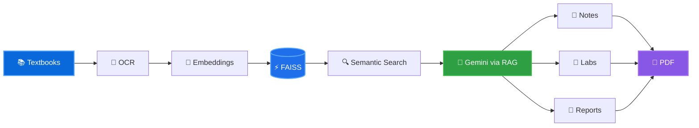

&lt;div align=&quot;center&quot;&gt;

&lt;!-- Animated Dragon Boss Fight Hero Scene (place dragon-battle.svg in your repo root) --&gt;
&lt;img src=&quot;./dragon-battle.svg&quot; width=&quot;100%&quot; alt=&quot;Animated Boss Fight: @SwayamX rushing to defeat the Production Bug Dragon&quot; /&gt;

<br/>

&lt;!-- Animated Battle Ticker --&gt;
&lt;img src=&quot;https://readme-typing-svg.demolab.com?font=JetBrains+Mono&amp;weight=800&amp;size=22&amp;duration=2500&amp;pause=800&amp;color=FB7185&amp;center=true&amp;vCenter=true&amp;width=840&amp;height=52&amp;lines=%F0%9F%90%89+ALERT%3A+Production+Bug+Dragon+Attacked+main!;%E2%9A%A1+%40SwayamX+rushed+in+with+Docker+Shield+%26+RAG+Spells;AI+Engineer+%7C+Full-Stack+Dev+%7C+C%2B%2B+Game+Dev+%7C+Taekwondo+%F0%9F%A5%8B;Status%3A+Bugs+Patched+%E2%80%A2+Server+Saved+%E2%80%A2+Ready+to+Join+Your+Party+%E2%9C%85&quot; alt=&quot;Animated Dragon Boss Fight Ticker&quot; /&gt;

<br/>

&lt;!-- Boss Fight Status Badges --&gt;


&lt;/div&gt;

---

## 🐉 Quest Log: Saving Production from the Bug Dragon

> **`QUEST #42: A wild Production Bug Dragon breathed 500 Errors on Friday night. @SwayamX sprinted in to patch the codebase and save the server.`**

Hi adventurer 👋 I'm **Swayam (`@SwayamX`)** — an **AI Engineer & Full-Stack Developer** who builds intelligent systems, ships clean interfaces, and treats production bugs like boss fights.

&lt;table&gt;
&lt;tr&gt;
&lt;td width=&quot;58%&quot; valign=&quot;top&quot;&gt;

### 🛡️ How I Counter the Dragon
- 🤖 **AI & RAG Magic** — LLM apps, retrieval pipelines, and semantic search
- 🌐 **Full-Stack Strikes** — React, Node.js, Express, plus battle-tested vanilla JS
- 🎮 **C++ / SFML Combat Engine** — Custom collisions, enemies, and player systems
- ☁️ **Docker & Cloud Armor** — Docker, AWS, Terraform, Jenkins, Ansible, Linux
- 🔐 **Cybersecurity Radar** — Always scanning for hidden traps and vulnerabilities

### 🚫 Debuffs Permanently Removed
- ❌ *"It works on my machine"* *(blocked permanently by **Docker Shield**)*

&lt;/td&gt;
&lt;td width=&quot;42%&quot; align=&quot;center&quot; valign=&quot;middle&quot;&gt;
  &lt;img src=&quot;https://api.memegen.link/images/drake/Reading_the_docs/Building_an_AI_that_reads_the_docs_for_me.png&quot; width=&quot;295&quot; alt=&quot;Drake meme about building an AI to read the docs&quot; /&gt;
&lt;/td&gt;
&lt;/tr&gt;
&lt;/table&gt;

---

## ⚔️ Combat Readiness & Bug-Fix Checks

```diff
+ ✓ Python ............................. CRIT HIT (PASSED)
+ ✓ C++ ................................ CRIT HIT (PASSED)
+ ✓ Java ............................... HIT (PASSED)
+ ✓ JavaScript ......................... HIT (PASSED)
+ ✓ SQL ................................ HIT (PASSED)
+ ✓ Generative AI / LLMs / RAG ......... SUPER EFFECTIVE (PASSED)
+ ✓ Docker Shield ...................... ACTIVE (PASSED)
- ✗ Sleep schedule ..................... FAILED (dragon attacked at 2 AM)
- ✗ Merge conflicts without crying ..... FLAKY
! ⚠ Dependency hell .................... SURVIVED WITH 1 HP
```

&lt;details&gt;
&lt;summary&gt;&lt;b&gt;🔥 Click to open Emergency Friday Deployment Battle Log&lt;/b&gt;&lt;/summary&gt;

<br/>

```text
[00:00.12] 🐉 PROD-BUG DRAGON used "500 Internal Server Error"!
[00:00.48] 🚨 Production server HP dropped to 12%!
[00:01.05] ⚡ @SwayamX rushed in with DOCKER SHIELD!
[00:01.90] 🥋 @SwayamX used National-Level Taekwondo Focus — zero panic, found the root cause.
[00:02.74] 🟢 @SwayamX cast `git commit -m "fix: dragon patched"` — CRITICAL HIT!
[00:03.10] ✅ All tests passing. Production saved!
```

&lt;div align=&quot;center&quot;&gt;
  &lt;img src=&quot;https://www.google.com/search?q=https://api.memegen.link/images/fine/Production\_is\_on\_fire/Me\_rushing\_in\_with\_a\_hotfix.png&quot; width=&quot;330&quot; alt=&quot;This is fine hotfix meme&quot; /&gt;
&lt;/div&gt;

&lt;/details&gt;

---

## 🔮 Ultimate Spell: AI Textbook & Lab Synthesizer

> Turns giant technical textbooks into structured study material using multi-book RAG and automated PDF generation.



&lt;div align=&quot;center&quot;&gt;


<br/><br/>

&lt;img src=&quot;https://api.memegen.link/images/buzz/Vectors/Vectors_everywhere.png&quot; width=&quot;300&quot; alt=&quot;Vectors everywhere meme&quot; /&gt;

&lt;/div&gt;

---

## 🧰 Armory & Weapon Loadout (Tech Stack)

&lt;div align=&quot;center&quot;&gt;

&lt;img src=&quot;https://skillicons.dev/icons?i=py,cpp,java,js,react,nodejs,express,html,css,tensorflow,pytorch,sklearn,mongodb,mysql,aws,docker,terraform,jenkins,ansible,git,linux&amp;perline=7&amp;theme=dark&quot; alt=&quot;Tech Stack Icons&quot; /&gt;

&lt;/div&gt;

<br/>

&lt;details open&gt;
&lt;summary&gt;&lt;b&gt;🗡️ Inspect Full Inventory Diff&lt;/b&gt;&lt;/summary&gt;

```diff
@@ Primary Weapons (Languages) @@
+ Python  C++  Java  JavaScript  SQL

@@ Arcane Arts (AI / ML) @@
+ TensorFlow  PyTorch  NumPy  Pandas  Scikit-learn
+ LangChain  LlamaIndex  RAG  LLMs

@@ Web Forge @@
+ HTML  CSS  React  Node.js  Express

@@ Vaults (Databases) @@
+ MongoDB  MySQL  Oracle

@@ Fortress & DevOps @@
+ AWS  Docker  Terraform  Jenkins  Ansible  Git  Linux
```

&lt;/details&gt;

---

## 📊 Live Battle Telemetry

&lt;div align=&quot;center&quot;&gt;

&lt;img height=&quot;175&quot; src=&quot;https://github-readme-stats.vercel.app/api?username=SwayamX&amp;show_icons=true&amp;theme=github_dark&amp;hide_border=true&amp;title_color=2EA043&amp;icon_color=FB7185&amp;text_color=C9D1D9&amp;bg_color=0D1117&quot; alt=&quot;SwayamX GitHub Stats&quot; /&gt;
&lt;img height=&quot;175&quot; src=&quot;https://github-readme-stats.vercel.app/api/top-langs/?username=SwayamX&amp;layout=compact&amp;theme=github_dark&amp;hide_border=true&amp;title_color=2EA043&amp;text_color=C9D1D9&amp;bg_color=0D1117&quot; alt=&quot;SwayamX Top Languages&quot; /&gt;

<br/>

&lt;img src=&quot;https://streak-stats.demolab.com/?user=SwayamX&amp;theme=github-dark-blue&amp;hide_border=true&amp;ring=2EA043&amp;fire=FB7185&amp;currStreakLabel=2EA043&amp;background=0D1117&quot; alt=&quot;SwayamX GitHub Streak&quot; /&gt;

<br/>

&lt;img src=&quot;https://github-readme-activity-graph.vercel.app/graph?username=SwayamX&amp;bg_color=0D1117&amp;color=C9D1D9&amp;line=2EA043&amp;point=FB7185&amp;area=true&amp;area_color=2EA043&amp;hide_border=true&quot; width=&quot;96%&quot; alt=&quot;SwayamX Contribution Activity Graph&quot; /&gt;

&lt;/div&gt;

---

## 💬 Guild Dialogue & Boss Encounters

&lt;table&gt;
&lt;tr&gt;
&lt;td width=&quot;56%&quot; valign=&quot;top&quot;&gt;

> **🧑‍💻 Guild Reviewer 1:** Wait—why does an AI engineer have a Taekwondo skill tree?
>
> **@SwayamX:** National-level Taekwondo discipline. When a production dragon breathes fire, you stay calm, spot the opening, and strike once. 🥋

> **🧑‍💻 Guild Reviewer 2:** Any dangerous habits we should know about?
>
> **@SwayamX:** I will say *"let me ship one more feature before deployment"* and actually mean it.

&lt;/td&gt;
&lt;td width=&quot;44%&quot; align=&quot;center&quot; valign=&quot;middle&quot;&gt;
  &lt;img src=&quot;https://www.google.com/search?q=https://api.memegen.link/images/stonks/Adding\_one\_more\_feature/Right\_before\_the\_boss\_fight.png&quot; width=&quot;295&quot; alt=&quot;Stonks meme about adding one more feature&quot; /&gt;
&lt;/td&gt;
&lt;/tr&gt;
&lt;/table&gt;

&lt;details&gt;
&lt;summary&gt;&lt;b&gt;⚠️ Mid-Battle Merge Conflict — Click to choose your fate&lt;/b&gt;&lt;/summary&gt;

<br/>

```text
<<<<<<< HEAD
I should sleep.
=======
The dragon is at 1 HP and the bug is almost fixed.
>>>>>>> swayam/ai-fullstack

Manual resolution: choose "one more hour".
```

&lt;div align=&quot;center&quot;&gt;
  &lt;img src=&quot;https://api.memegen.link/images/rollsafe/Can&https://www.google.com/search?q=%2339;t_spawn_a_production_dragon/If_you_never_deploy.png&quot; width=&quot;320&quot; alt=&quot;Roll safe meme about deploying&quot; /&gt;
&lt;/div&gt;

&lt;/details&gt;

---

## 🏆 Character Sheet & Recruit Options

&lt;table&gt;
&lt;tr&gt;
&lt;td width=&quot;52%&quot; valign=&quot;top&quot;&gt;

### 🎖️ Hero Stats

| Attribute | Rank / Value |
| :--- | :--- |
| 🥋 **Discipline** | National-Level Taekwondo |
| 🎓 **Origin** | Computer Science Engineering |
| 🔬 **Specialization** | AI / ML / Generative AI |
| 🎮 **Side Quests** | C++ Game Development |
| 📊 **Superpower** | Data Analytics & Insights |
| 🐛 **Bugs Spawned** | Statistically non-zero |
| 🐉 **Bugs Slain** | Statistically more |

&lt;/td&gt;
&lt;td width=&quot;48%&quot; valign=&quot;top&quot;&gt;

### 🚦 Summon `@SwayamX` to Your Party

- [x] **Squash & Recruit** — hire me, I'll ship fast
- [x] **Rebase & Recruit** — keep the commit lore
- [x] **Co-op Quest** — let's build something cool
- [ ] ~~Flee from the Dragon~~ *(disabled by repo admin)*

<br/>

&lt;div align=&quot;center&quot;&gt;
  &lt;img src=&quot;https://www.google.com/search?q=https://api.memegen.link/images/success/Slayed\_the\_bug\_dragon/Without\_spawning\_three\_more.png&quot; width=&quot;275&quot; alt=&quot;Success kid meme about slaying the bug dragon&quot; /&gt;
&lt;/div&gt;

&lt;/td&gt;
&lt;/tr&gt;
&lt;/table&gt;

---

&lt;div align=&quot;center&quot;&gt;

### 🟢 Production is safe — ready to join your team!

<br/>

[](#)
[](#)
[](#)


<br/><br/>

&lt;sub&gt;LGTM 👍 · Approved by Future You&lt;/sub&gt;

&lt;!-- Animated Wave Footer --&gt;
&lt;img src=&quot;https://capsule-render.vercel.app/api?type=waving&amp;color=0:E11D48,50:2EA043,100:8957E5&amp;height=130&amp;section=footer&amp;text=Dragon%20Patched%20%F0%9F%90%89%20%E2%80%A2%20Production%20Saved!&amp;fontSize=20&amp;fontColor=ffffff&amp;fontAlignY=72&amp;animation=fadeIn&quot; width=&quot;100%&quot; alt=&quot;Animated Wave Footer&quot; /&gt;

&lt;/div&gt;
