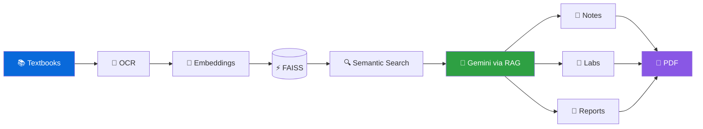

<div align="center">


-2EA043?style=for-the-badge)


</div>

---

## 📝 Title

> **`feat: add AI engineer who also ships full-stack, games and the occasional taekwondo kick`**

`SwayamX` wants to merge **1 engineer** into `your-team:main`

| Branch | `swayam/ai-fullstack` → `main` |
|---|---|
| Labels | `enhancement` `AI/ML` `full-stack` `good first hire` `needs-coffee` |
| Assignee | You (after merge, me) |
| Milestone | Ship something people actually use |

---

## 📖 Description

Hi reviewers 👋

This PR introduces an **AI Engineer / Full-Stack Developer** who builds intelligent systems that solve real problems, then wraps them in interfaces people actually enjoy using.

**What changed**
- 🤖 Added LLM apps, RAG pipelines and semantic search
- 🌐 Added full-stack products (React, Node, Express, plus a lot of vanilla JS)
- 🎮 Added C++ / SFML game mechanics (collisions, enemies, player systems)
- ☁️ Added Docker, cloud and DevOps knowledge
- 🛡️ Added curiosity about cybersecurity

**What did NOT change**
- ❌ The ability to say "it works on my machine" (fixed with Docker)

<div align="center">


</div>

---

## ✅ CI Checklist

```diff
+ ✓ Python ............................. PASSED
+ ✓ C++ ................................ PASSED
+ ✓ Java ............................... PASSED
+ ✓ JavaScript ......................... PASSED
+ ✓ SQL ................................ PASSED
+ ✓ Generative AI / LLMs / RAG ......... PASSED
+ ✓ Docker .............................. PASSED
- ✗ Sleep schedule ..................... FAILED (known issue, won't fix)
- ✗ Merge conflicts without crying ...... FLAKY
! ⚠ Dependency hell ..................... SURVIVED
```

<div align="center">


</div>

---

## 🧪 Feature Spotlight: AI Textbook & Lab Synthesizer

Turns technical textbooks into structured study material using RAG.



Multi-book retrieval · FAISS similarity search · intelligent query routing · automatic format detection · professional PDF output

<div align="center">


</div>

---

## 🧰 Tech Stack (the diff)

```diff
@@ Languages @@
+ Python  C++  Java  JavaScript  SQL

@@ AI / ML @@
+ TensorFlow  PyTorch  NumPy  Pandas  Scikit-learn
+ LangChain  LlamaIndex  RAG  LLMs

@@ Web @@
+ HTML  CSS  React  Node.js  Express

@@ Data @@
+ MongoDB  MySQL  Oracle

@@ Cloud / DevOps @@
+ AWS  Docker  Terraform  Jenkins  Ansible  Git  Linux
```

<div align="center">


</div>

---

## 💬 Review Comments

> **🧑‍💻 Reviewer 1:** Why is there a taekwondo commit in an AI engineer's history?
>
> **SwayamX:** National-level discipline. It transfers to debugging: stay calm, find the opening, strike once. 🥋

> **🧑‍💻 Reviewer 2:** Any concerns?
>
> **SwayamX:** Only that I'll ask "one more feature before we deploy" and mean it.

<div align="center">


</div>

---

## ⚠️ Merge Conflicts Detected

```text
<<<<<<< HEAD
I should sleep.
=======
But the bug is so close.
>>>>>>> swayam/ai-fullstack

Resolve manually: choose "one more hour".
```

<div align="center">


</div>

---

## 🏆 Merge Impact

| Metric | Value |
|---|---|
| 🥋 Discipline | National-Level Taekwondo |
| 🎓 Foundation | Computer Science Engineering |
| 🔬 Research | AI / ML / Generative AI |
| 🎮 Side quests | C++ game development |
| 📊 Superpower | Data analytics & insights |
| 🐛 Bugs introduced | Statistically non-zero |
| 🐛 Bugs fixed | Statistically more |

---

## 🚦 Merge Options

- [x] **Squash and merge**: hire me, I'll ship fast
- [x] **Rebase and merge**: keep the history, keep the lore
- [x] **Create a merge commit**: let's talk first
- [ ] ~~Close without merging~~ *(disabled by repo admin)*

<div align="center">


<br/><br/>

### 🟢 This branch has no conflicts with your team

**[💼 LinkedIn](#)** · **[📧 Email](#)** · **[🌐 Portfolio](#)**


<sub>LGTM 👍 · Approved by Future You</sub>


</div>
