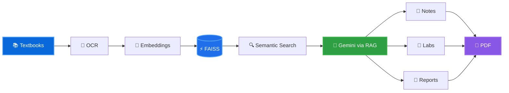

<div align="center">

<!-- Animated Dragon Boss Fight Hero Scene (dragon-battle.svg must sit in the repo root next to README.md) -->


<br/>

<!-- Animated Battle Ticker -->


<br/>

<!-- Boss Fight Status Badges -->


</div>

---

## 🐉 Quest Log: Saving Production from the Bug Dragon

> **`QUEST #42: A wild Production Bug Dragon breathed 500 Errors on Friday night. @SwayamX sprinted in to patch the codebase and save the server.`**

Hi adventurer 👋 I'm **Swayam (`@SwayamX`)** — an **AI Engineer & Full-Stack Developer** who builds intelligent systems, ships clean interfaces, and treats production bugs like boss fights.

<table>
<tr>
<td width="58%" valign="top">

### 🛡️ How I Counter the Dragon
- 🤖 **AI & RAG Magic** — LLM apps, retrieval pipelines, and semantic search
- 🌐 **Full-Stack Strikes** — React, Node.js, Express, plus battle-tested vanilla JS
- 🎮 **C++ / SFML Combat Engine** — Custom collisions, enemies, and player systems
- ☁️ **Docker & Cloud Armor** — Docker, AWS, Terraform, Jenkins, Ansible, Linux
- 🔐 **Cybersecurity Radar** — Always scanning for hidden traps and vulnerabilities

### 🚫 Debuffs Permanently Removed
- ❌ *"It works on my machine"* *(blocked permanently by **Docker Shield**)*

</td>
<td width="42%" align="center" valign="middle">
  
</td>
</tr>
</table>

---

## ⚔️ Combat Readiness & Bug-Fix Checks

```diff
+ ✓ Python ............................. CRIT HIT (PASSED)
+ ✓ C++ ................................ CRIT HIT (PASSED)
+ ✓ Java ............................... HIT (PASSED)
+ ✓ JavaScript ......................... HIT (PASSED)
+ ✓ SQL ................................ HIT (PASSED)
+ ✓ Generative AI / LLMs / RAG ......... SUPER EFFECTIVE (PASSED)
+ ✓ Docker Shield ...................... ACTIVE (PASSED)
- ✗ Sleep schedule ..................... FAILED (dragon attacked at 2 AM)
- ✗ Merge conflicts without crying ..... FLAKY
! ⚠ Dependency hell .................... SURVIVED WITH 1 HP
```

<details>
<summary><b>🔥 Click to open Emergency Friday Deployment Battle Log</b></summary>

<br/>

```text
[00:00.12] 🐉 PROD-BUG DRAGON used "500 Internal Server Error"!
[00:00.48] 🚨 Production server HP dropped to 12%!
[00:01.05] ⚡ @SwayamX rushed in with DOCKER SHIELD!
[00:01.90] 🥋 @SwayamX used National-Level Taekwondo Focus — zero panic, found the root cause.
[00:02.74] 🟢 @SwayamX cast `git commit -m "fix: dragon patched"` — CRITICAL HIT!
[00:03.10] ✅ All tests passing. Production saved!
```

<div align="center">
  
  &nbsp;
  
</div>

</details>

---

## 🔮 Ultimate Spell: AI Textbook & Lab Synthesizer

> Turns giant technical textbooks into structured study material using multi-book RAG and automated PDF generation.



<div align="center">


&nbsp;


</div>

---

## 🧰 Armory & Weapon Loadout (Tech Stack)

<div align="center">


</div>

<br/>

<details open>
<summary><b>🗡️ Inspect Full Inventory Diff</b></summary>

```diff
@@ Primary Weapons (Languages) @@
+ Python  C++  Java  JavaScript  SQL

@@ Arcane Arts (AI / ML) @@
+ TensorFlow  PyTorch  NumPy  Pandas  Scikit-learn
+ LangChain  LlamaIndex  RAG  LLMs

@@ Web Forge @@
+ HTML  CSS  React  Node.js  Express

@@ Vaults (Databases) @@
+ MongoDB  MySQL  Oracle

@@ Fortress & DevOps @@
+ AWS  Docker  Terraform  Jenkins  Ansible  Git  Linux
```

<div align="center">
  
</div>

</details>

---

## 📊 Live Battle Telemetry

<div align="center">


<br/>


<br/>


<br/><br/>


</div>

---

## 💬 Guild Dialogue & Boss Encounters

<table>
<tr>
<td width="56%" valign="top">

> **🧑‍💻 Guild Reviewer 1:** Wait—why does an AI engineer have a Taekwondo skill tree?
>
> **@SwayamX:** National-level Taekwondo discipline. When a production dragon breathes fire, you stay calm, spot the opening, and strike once. 🥋

> **🧑‍💻 Guild Reviewer 2:** Any dangerous habits we should know about?
>
> **@SwayamX:** I will say *"let me ship one more feature before deployment"* and actually mean it.

</td>
<td width="44%" align="center" valign="middle">
  
</td>
</tr>
</table>

<details>
<summary><b>⚠️ Mid-Battle Merge Conflict — Click to choose your fate</b></summary>

<br/>

```text
<<<<<<< HEAD
I should sleep.
=======
The dragon is at 1 HP and the bug is almost fixed.
>>>>>>> swayam/ai-fullstack

Manual resolution: choose "one more hour".
```

<div align="center">
  
  &nbsp;
  
</div>

</details>

---

## 🏆 Character Sheet & Recruit Options

<table>
<tr>
<td width="52%" valign="top">

### 🎖️ Hero Stats

| Attribute | Rank / Value |
| :--- | :--- |
| 🥋 **Discipline** | National-Level Taekwondo |
| 🎓 **Origin** | Computer Science Engineering |
| 🔬 **Specialization** | AI / ML / Generative AI |
| 🎮 **Side Quests** | C++ Game Development |
| 📊 **Superpower** | Data Analytics & Insights |
| 🐛 **Bugs Spawned** | Statistically non-zero |
| 🐉 **Bugs Slain** | Statistically more |

</td>
<td width="48%" valign="top">

### 🚦 Summon `@SwayamX` to Your Party

- [x] **Squash & Recruit** — hire me, I'll ship fast
- [x] **Rebase & Recruit** — keep the commit lore
- [x] **Co-op Quest** — let's build something cool
- [ ] ~~Flee from the Dragon~~ *(disabled by repo admin)*

<br/>

<div align="center">
  
</div>

</td>
</tr>
</table>

---

<div align="center">

### 🟢 Production is safe — ready to join your team!

<br/>

<a href="https://github.com/SwayamX"></a>
<a href="https://www.linkedin.com/in/"></a>
<a href="mailto:your-email@example.com"></a>

<br/><br/>


<br/><br/>

<sub>LGTM 👍 · Approved by Future You</sub>

<!-- Animated Wave Footer -->


</div>
